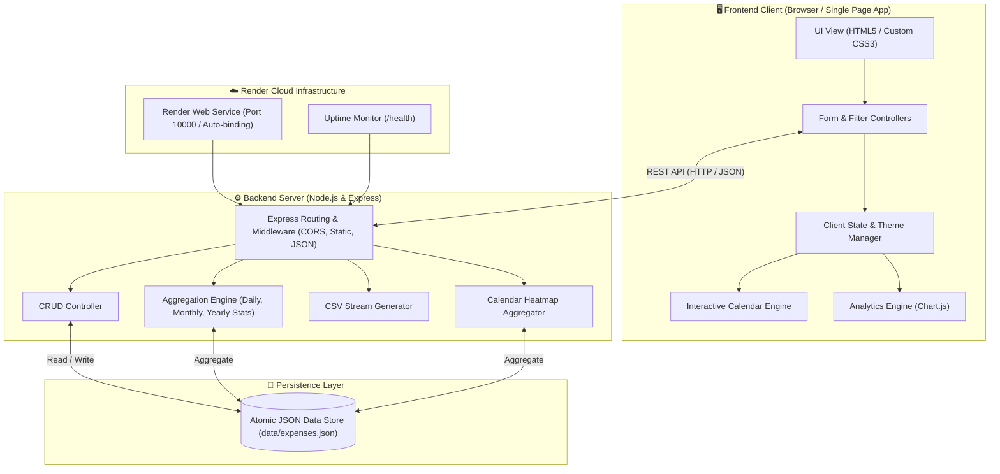

# 💎 TrackWise - Smart Expense Tracker Web Application

> **A fullstack personal finance management dashboard built on modern web technologies, inspired by and expanded from a classic C console application into a cloud-deployed, feature-rich web platform.**

[](https://expencestracker-f45t.onrender.com)
[](https://nodejs.org/)
[](LICENSE)

---

## 🌐 Live Production Deployment

🚀 **Live URL**: [https://expencestracker-f45t.onrender.com](https://expencestracker-f45t.onrender.com)

Hosted as a live cloud Web Service on **Render** with continuous health checks and zero cold-start configurations.

---

## 🏛️ Detailed System Architecture

The application adopts a **Layered Client-Server Architecture** designed for high responsiveness, zero build step overhead, and reliable cloud persistence.



---

### 1. Presentation Layer (Frontend SPA)
* **Zero-Build Architecture**: Runs natively using vanilla modern ES6+ JavaScript, CSS3 variables, and HTML5 semantic elements without heavy bundler dependencies, ensuring ultra-fast load times and zero compilation failure risks on cloud hosts.
* **Interactive Navigation Calendar**:
  - Dynamically computes month matrices (with correct day offsets).
  - Integrates with the backend calendar API to render day-specific spending badges and indicator dots.
  - Acts as an interactive visual filter: clicking any day immediately narrows the transaction view and analytical charts to that specific date.
* **Visualization & Analytics Engine**:
  - Integrates **Chart.js** to generate reactive donut charts (category expense breakdown) and monthly bar charts (12-month annual spending trends).
  - Synchronizes with theme changes dynamically.
* **Strictly Non-Blue Design System**:
  - Engineered from the ground up without blue or blue-white combinations.
  - Combines **Emerald Green** (`#10b981`), **Honey Amber** (`#f59e0b`), **Terracotta / Warm Tangerine** (`#ea580c`), **Amethyst / Violet** (`#8b5cf6`), and **Crimson Rose** (`#e11d48`).
  - Supports dual themes: **Obsidian-Forest Dark Mode** and **Warm Linen Cream Light Mode**.

---

### 2. Application & API Layer (Backend Express Server)
* **Runtime**: Node.js (v18+) with Express 5.
* **Middleware Stack**:
  - `cors()`: Cross-Origin Resource Sharing.
  - `express.json()`: Body parsing for JSON payloads.
  - `express.static()`: High-performance static asset serving for client files.
* **Core Subsystems**:
  - **CRUD Controller**: Manages expense creation, retrieval, updates, and deletion with input validation and sanitization.
  - **Aggregation Engine**: Calculates today's spending, current month running total, annual cumulative expenditures, top spending category, and monthly historical trends.
  - **Calendar Aggregator**: Maps expenses to `YYYY-MM-DD` buckets for fast month-view rendering.
  - **CSV Export Streamer**: Formats expense collections into RFC-compliant CSV files for spreadsheet downloads.
  - **Health Monitoring Endpoint** (`/health`): Used by Render's automated health checkers to monitor process uptime.

---

### 3. Persistence & Storage Layer
* **Data Store**: `data/expenses.json` with structured schemas:
  ```json
  {
    "id": "exp_1713254400000_abc",
    "amount": 450.00,
    "category": "Food",
    "otherCategoryName": "",
    "date": "2026-10-16",
    "description": "Lunch meeting",
    "paymentMethod": "UPI",
    "createdAt": "2026-10-16T10:20:00.000Z"
  }
  ```
* **Resilient Initialization**: If no storage file exists, the server automatically initializes realistic demo data across multiple dates and categories so users can explore the app immediately upon first launch.

---

### 4. Evolution: C Console Application to Cloud Web Architecture

| Dimension | Original C Application (`main.c`) | TrackWise Fullstack Platform |
|---|---|---|
| **Interface** | Terminal CLI (`printf` / `scanf`) | Responsive Web GUI with Glassmorphic UI |
| **Categories** | 6 static categories (Food, Cloths, Medical, Enjoyment, Fees, Travelling) | Original 6 + **Dynamic "Other" (User-defined custom category)** |
| **Time Tracking** | Single execution session (in-memory) | **Daily, Monthly, and Yearly automated aggregations** |
| **Navigation** | Sequential numeric prompts (1–7) | **Interactive Visual Calendar with date-click filtering** |
| **Visuals** | Plain terminal monochrome text | **Chart.js Donut & Bar Charts (Strictly Non-Blue Palette)** |
| **Data Persistence** | None (lost on program exit) | **File-backed JSON database + CSV export** |
| **Deployment** | Local compilation (`gcc main.c`) | **Cloud-deployed on Render with auto-scaling** |

---

## ✨ Features Summary

1. 🍔 **Full Category Suite + Custom "Other" Option**:
   - Food, Cloths, Medical, Enjoyment, Fees, Travelling.
   - Selecting **"Other"** displays a dynamic input allowing the user to specify custom labels (e.g. *Groceries*, *Gym*, *Electronics*, *Electricity Bill*, etc.).
2. 📅 **Interactive Calendar Navigation**:
   - Navigate month-to-month and jump to "Today".
   - Days with expenses show gold badges and indicator dots.
   - 1-click on any day filters all expenses to that specific date.
3. 📊 **Daily, Monthly & Yearly Aggregations**:
   - Instant calculation of daily total (today), monthly total, yearly total, and all-time spending.
   - Quick filter tabs: **All**, **Today**, **This Month**, **This Year**.
4. 🎨 **Strictly Non-Blue Theme System**:
   - No blue or blue-white colors anywhere in the app.
   - Elegant **Emerald, Amber, Terracotta, Amethyst, and Crimson** palette.
   - Theme toggle between Obsidian Forest (Dark) and Warm Linen (Light).
5. 💱 **Multi-Currency Support**:
   - Select between ₹ INR, $ USD, € EUR, and £ GBP with immediate currency recalculation.
6. 📥 **Data Export & Management**:
   - Export all records to CSV.
   - Search by description, category, custom label, or amount.
   - Edit and delete expenses with confirmation modals.

---

## 📁 Repository Directory Structure

```
Expences tracker/
├── data/
│   └── expenses.json          # Persistent JSON database
├── public/
│   ├── css/
│   │   └── style.css          # Non-blue color palette, responsive CSS & animations
│   ├── js/
│   │   └── app.js             # Interactive calendar, chart renderer, CRUD logic
│   ├── index.html             # Responsive Single Page Application
│   └── favicon.svg            # Custom emerald/amber wallet icon
├── server.js                  # Express backend with aggregation pipelines
├── render.yaml                # Render Blueprint deployment configuration
├── package.json               # Node.js dependencies, scripts & engines
├── .gitignore                 # Excluded files (node_modules, logs)
├── main.c                     # Original C console application
└── README.md                  # Comprehensive documentation & architecture guide
```

---

## 🛠️ REST API Specification

| Method | Endpoint | Description |
|---|---|---|
| `GET` | `/health` | Health check endpoint returning uptime and status |
| `GET` | `/api/expenses` | List expenses (filterable by `category`, `search`, `date`, `month`, `year`, `sort`) |
| `GET` | `/api/expenses/summary` | Aggregated metrics for Daily, Monthly, Yearly, and Category breakdown |
| `GET` | `/api/expenses/calendar` | Day-by-day totals and transaction counts for a given month/year |
| `POST` | `/api/expenses` | Create a new expense record |
| `PUT` | `/api/expenses/:id` | Update an existing expense record |
| `DELETE`| `/api/expenses/:id` | Delete an expense record |
| `GET` | `/api/expenses/export` | Download all expense records as a CSV file |
| `POST` | `/api/expenses/reset-sample` | Reset database to initial sample dataset |

---

## 🚀 Local Setup & Installation

### Prerequisites
- [Node.js](https://nodejs.org/) (version 18 or above)
- [npm](https://www.npmjs.com/)

### Steps
1. **Clone the repository**:
   ```bash
   git clone https://github.com/PravallikaBanka02/Expencestracker.git
   cd Expencestracker
   ```

2. **Install dependencies**:
   ```bash
   npm install
   ```

3. **Start the server**:
   ```bash
   npm start
   ```

4. **Access the application**:
   Open [http://localhost:3000](http://localhost:3000) in your web browser.

---

## ☁️ Deployment on Render

This project is configured with [`render.yaml`](render.yaml) for automatic continuous deployment.

1. Push your repository to GitHub.
2. In [Render Dashboard](https://dashboard.render.com), click **New +** → **Blueprint** (or **Web Service**).
3. Connect your repository (`PravallikaBanka02/Expencestracker`).
4. Render automatically detects the configuration:
   - **Environment**: `Node`
   - **Build Command**: `npm install`
   - **Start Command**: `npm start`
   - **Plan**: `Free`
5. Click **Deploy** to publish the live application.
